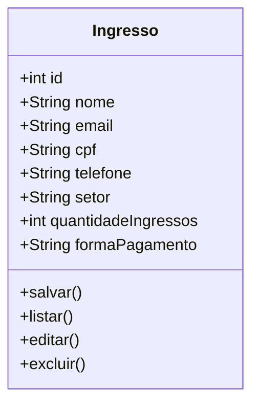
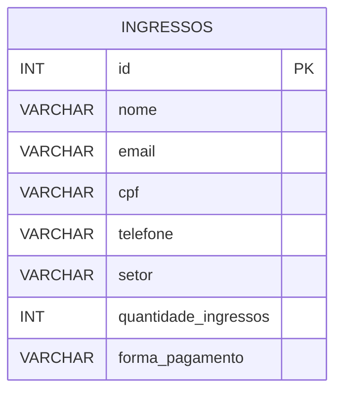

# Modelagem e criação do banco de dados - Fórmula 1

## 1. Objetivo

O banco de dados foi modelado para armazenar as informações relacionadas à compra de ingressos do evento de Fórmula 1, permitindo o cadastro, a listagem, a edição e a exclusão das informações pelo sistema.

## 2. Diagrama de Classes / UML revisado



## 3. Diagrama ER (Entidade-Relacionamento)



## 4. Estrutura das tabelas do banco

A tabela principal do sistema é a tabela `ingressos`, responsável por guardar os dados dos compradores e dos ingressos adquiridos.

```sql
CREATE DATABASE IF NOT EXISTS formula1;

USE formula1;

CREATE TABLE ingressos (
    id INT AUTO_INCREMENT PRIMARY KEY,
    nome VARCHAR(100) NOT NULL,
    email VARCHAR(100) NOT NULL,
    cpf VARCHAR(20) NOT NULL UNIQUE,
    telefone VARCHAR(20) NOT NULL,
    setor VARCHAR(50) NOT NULL,
    quantidade_ingressos INT NOT NULL DEFAULT 1,
    forma_pagamento VARCHAR(50) NOT NULL
);
```

## 5. Conexão inicial do sistema com o banco

A conexão com o banco foi criada no arquivo de configuração do projeto:

- `config/conexao.php`

Código principal:

```php
<?php

$servidor = "localhost";
$usuario = "root";
$senha = "";
$banco = "formula1";

$conexao = mysqli_connect($servidor, $usuario, $senha, $banco);

if(!$conexao){
    die("Erro na conexão: " . mysqli_connect_error());
}

?>
```

Essa conexão permite que as páginas do sistema realizem operações como:

- cadastro de ingressos em `salvar.php`
- listagem em `listar.php`
- edição em `editar.php`
- exclusão em `excluir.php`

## 6. Verificação do funcionamento

A base do sistema já está integrada ao banco e a sintaxe dos arquivos PHP foi validada com sucesso, sem erros de estrutura.

## 7. Checklist do item concluído

- [x] Modelagem inicial do banco
- [x] Criação da estrutura da tabela
- [x] Banco funcionando como base principal do sistema
- [x] Conexão inicial com o banco configurada
- [x] Utilização do banco em operações de cadastro e listagem
- [x] Diagrama de classes/UML revisado

## 8. Observação final

A estrutura atual atende ao escopo inicial do projeto. Ela funciona como um modelo base para o gerenciamento de ingressos e pode evoluir futuramente para uma modelagem mais robusta, com tabelas separadas para clientes, compras, pagamentos e setores, caso o sistema cresça.
